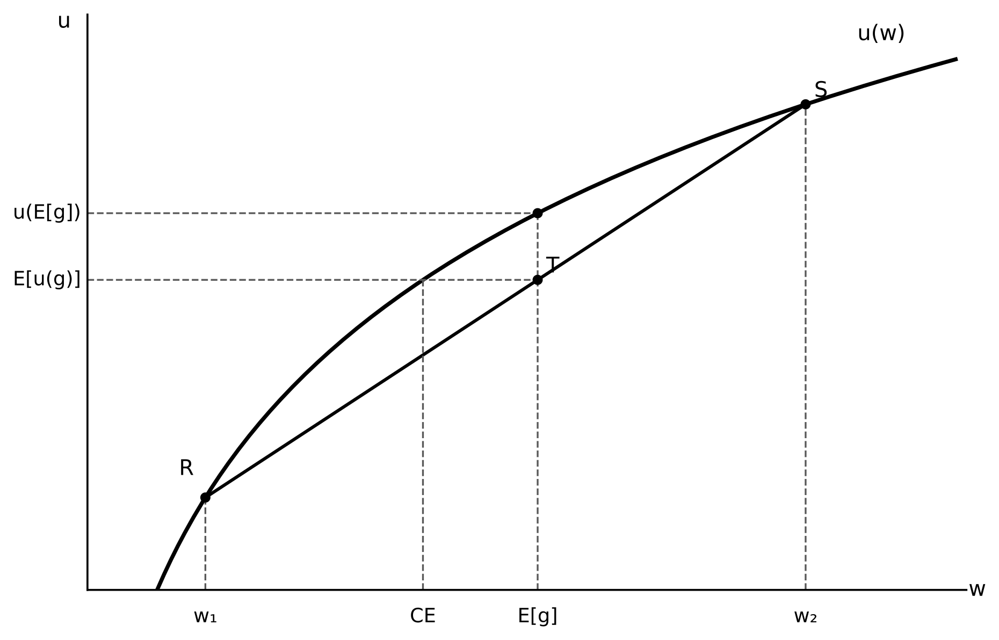

# Sharing Model Uncertainty

**Paper:** Hara, C., Mukerji, S., Riedel, F., & Tallon, J.-M. (2026). *Sharing Model Uncertainty*. *American Economic Journal: Microeconomics*, 18(2), 313–347. [DOI](https://doi.org/10.1257/mic.20240188).

These notes currently focus on Sections 1.1–1.2 of Sharing Model Uncertainty. To better understand the paper's treatment of model uncertainty and ambiguity aversion, I begin with the expected utility framework as a theoretical foundation for distinguishing risk from ambiguity. Some related concepts from microeconomic theory are included to clarify the intuition and support my own understanding, although they are not all directly used in the paper.

&nbsp;

## 1. Prerequisite Knowledge

### 1.1 A Simple Case of Uncertainty: A Gamble

Consider a simple case of uncertainty, such as a gamble $g$ with known outcome probabilities.

Suppose the Bernoulli utility function $u(w)$ is increasing and strictly concave, with

```math
u'(w)>0,\qquad u''(w)<0.
```

By **Jensen's Inequality**,

```math
\boxed{u(\mathbb{E}[g])\geq\mathbb{E}[u(g)]}.
```

- $u(\mathbb{E}[g])$: The utility of receiving the expected payoff **without taking the gamble**.
- $\mathbb{E}[u(g)]$: The expected utility of **taking the gamble**.

For a nondegenerate gamble, the inequality is strict. This captures **risk aversion**: receiving the expected payoff with certainty is preferred to facing the gamble.

> **Example:** Consider a gamble paying €10 or −€2, each with probability 0.5. Given $u(10)=1$, $u(-2)=0$, and $u(4)=0.6$, we obtain $\mathbb{E}[g]=4$ and $\mathbb{E}[u(g)]=0.5$, while $u(\mathbb{E}[g])=0.6$. Hence, the certain €4 is preferred to the gamble. The value $u(4)=0.6$ is obtained from a separate indifference comparison with a 60%/40% gamble.

The intuition can also be seen geometrically: **a concave utility curve lies above the straight chord connecting two possible outcomes**, as illustrated below.



*Figure 1. Jensen's Inequality, Certainty Equivalent, and Risk Premium.*

&nbsp;

### 1.2 Certainty Equivalent and Risk Premium

#### Understanding the Straight Line in Figure 1

Suppose the gamble has two possible outcomes, $w_1$ and $w_2$, with probabilities $p$ and $1-p$.

The points on the utility curve are

```math
R=(w_1,u(w_1)),\qquad S=(w_2,u(w_2)).
```

The straight chord connecting $R$ and $S$ is given by

```math
L(w)=u(w_1)
+\frac{u(w_2)-u(w_1)}{w_2-w_1}(w-w_1).
```

At the expected payoff,

```math
\mathbb{E}[g]=pw_1+(1-p)w_2,
```

the chord gives

```math
\boxed{
L(\mathbb{E}[g])
=pu(w_1)+(1-p)u(w_2)
=\mathbb{E}[u(g)]
}.
```

This is point $T$ in the figure.

Since the utility function is concave, the utility curve lies above the chord:

```math
u(\mathbb{E}[g])>\mathbb{E}[u(g)].
```

In other words, the curve and the straight line evaluate the same expected payoff, but give different utility values.

#### Certainty Equivalent (CE)

The Certainty Equivalent is the certain payoff that gives the same utility as taking the gamble:

```math
\boxed{u(CE)=\mathbb{E}[u(g)]}.
```

In Figure 1, $CE$ is found by moving horizontally from $T$ to the utility curve, then vertically down to the wealth axis.

For a risk-averse individual,

```math
CE<\mathbb{E}[g].
```

#### Risk Premium (RP)

The Risk Premium measures how much of the expected payoff an individual is willing to give up to avoid the risk:

```math
\boxed{RP=\mathbb{E}[g]-CE}.
```

Graphically, it is the horizontal distance between $CE$ and $\mathbb{E}[g]$.

&nbsp;

### 1.3 Measuring Risk Aversion: Arrow–Pratt

The **Arrow–Pratt coefficient of absolute risk aversion** measures the local degree of risk aversion:

```math
\boxed{
A(w)=-\frac{u''(w)}{u'(w)}
}.
```

It captures the curvature of the utility function relative to its slope. Under the assumptions above, $A(w)>0$.

A higher coefficient indicates greater local absolute risk aversion.

Unlike the risk premium, which depends on a particular gamble, the Arrow–Pratt measure describes preferences at a given wealth level.

---

So far, the probability distribution of the gamble has been treated as known. **What if the probability model itself is uncertain?** This leads to the distinction between risk aversion and ambiguity aversion.


&nbsp;


## 2. From Risk Aversion to Ambiguity Aversion

### 2.1 Risk Aversion vs. Ambiguity Aversion

In the previous gamble, the probability distribution was known. **Risk aversion** concerns uncertainty over outcomes within a given probability model, captured by the concavity of the Bernoulli utility function $u$.

But what if the probability model itself is uncertain?

This introduces **model uncertainty**. In the smooth ambiguity framework, ambiguity aversion concerns how individuals evaluate uncertainty across different probability models, captured by the concavity of a second-layer function $\phi$.

- **Risk aversion:** Concavity of $u$ — uncertainty within a model.
- **Ambiguity aversion:** Concavity of $\phi$ — uncertainty across models.

&nbsp;

### 2.2 A Simple Ambiguity Case Before the Paper's Original Notation

Suppose a consumer faces two possible consumption outcomes:

```math
C\in\{0,100\}.
```

There are two possible probability models:

- **Boom:** $P_B$
- **Bust:** $P_b$

Each model specifies a complete probability distribution over the set of possible outcomes, rather than the probability of a single event.

| Consumption | Boom $P_B$ | Bust $P_b$ |
|:--|--:|--:|
| $100$ | 90% | 10% |
| $0$ | 10% | 90% |

Assume that

```math
u(c)=\sqrt c.
```

The expected utilities under the two models are

```math
\begin{aligned}
\mathbb{E}_{P_B}[u(C)]
&=0.9\sqrt{100}+0.1\sqrt0=9,\\
\mathbb{E}_{P_b}[u(C)]
&=0.1\sqrt{100}+0.9\sqrt0=1.
\end{aligned}
```

If we know that the Boom model is the true model, we only need to face the risk within Boom.

However, we do not know whether the economy actually follows Boom or Bust. We therefore face **model uncertainty**.

The set of possible models is

```math
\boxed{\mathcal P=\{P_B,P_b\}}.
```

Notice that both models allow the same outcomes, but assign different probabilities to them. The uncertainty is therefore not only about which outcome will occur, but also about which probability model applies.

&nbsp;

### 2.3 Two Consumers: Amy and Mia

Now suppose there are two consumers, **Amy** and **Mia**.

They share the same **prior beliefs** about the models:

```math
\mu(\{P_B\})=\mu(\{P_b\})=0.5.
```

They also have the same Bernoulli utility function $u(c)=\sqrt c$, but their attitudes toward model uncertainty differ.

#### Amy: Ambiguity-Averse

Amy dislikes the dispersion in expected utility between Boom and Bust, especially the possibility of receiving relatively low expected utility under Bust.

Suppose her second-layer utility function is

```math
\phi_{\mathrm{Amy}}(v)=\sqrt v.
```

Then

```math
\begin{aligned}
U_{\mathrm{Amy}}
&=0.5\phi_{\mathrm{Amy}}(9)
+0.5\phi_{\mathrm{Amy}}(1)\\
&=0.5\sqrt9+0.5\sqrt1\\
&=\boxed{2}.
\end{aligned}
```

Amy is ambiguity-averse because $\phi_{\mathrm{Amy}}$ is concave.

&nbsp;

#### Mia: Ambiguity-Neutral

Mia is ambiguity-neutral. Her second-layer utility function is linear:

```math
\phi_{\mathrm{Mia}}(v)=v.
```

Therefore,

```math
\begin{aligned}
U_{\mathrm{Mia}}
&=0.5(9)+0.5(1)\\
&=\boxed{5}.
\end{aligned}
```

Mia simply averages the expected utilities under Boom and Bust.

Amy and Mia have the same prior beliefs and risk preferences, but differ in their attitudes toward ambiguity.

*Note: The values $2$ and $5$ come from different utility representations and should not be compared directly as interpersonal welfare levels.*

&nbsp;


### 2.4 Concavity and the Ambiguity-Related Jensen Gap

**Risk aversion (within a model):**

```math
u_i(c_i),\qquad u_i'(c_i)>0,\quad u_i''(c_i)<0.
```

```math
\mathbb{E}_P[u_i(X_i^P)]
```

**Ambiguity aversion (across models):**

```math
\phi_i\left(\mathbb{E}_P[u_i(X_i^P)]\right),
\qquad \phi_i''<0.
```

For example,

```math
\phi_i(v)=\sqrt v.
```

By Jensen's inequality,

```math
\boxed{
\phi_i\left(
\mathbb E_\mu[\mathbb E_P[u_i(X_i^P)]]
\right)
\geq
\mathbb E_\mu\left[
\phi_i\left(\mathbb E_P[u_i(X_i^P)]\right)
\right]
}.
```

The gap reflects the effect of concavity across models, rather than an explicit penalty subtracted from utility.

&nbsp;

## 3. The Formula in *Sharing Model Uncertainty*

### 3.1 From the Simple Example to the Paper's Notation

**Consumer and consumption:**

```math
i,\qquad X_i,\qquad X_i^P
```

**Probability models:**

```math
P_B,\qquad P_b,\qquad
\mathcal P=\{P_B,P_b\}.
```

**Prior beliefs over models:**

```math
\mu(\{P\}),\qquad
\mu(\{P_B\})=\mu(\{P_b\})=0.5.
```

**Expected utility within each model:**

```math
\mathbb E_P[u_i(X_i^P)]
```

**Ambiguity transformation:**

```math
\phi_i\left(\mathbb E_P[u_i(X_i^P)]\right)
```

Here, $P$ specifies a probability distribution over outcomes, whereas $\mu$ assigns prior probabilities to the models themselves.

&nbsp;

### 3.2 The Two-Model Formula

For a finite set of models:

```math
\boxed{
U_i(X_i)
=
\sum_{P\in\mathcal P}
\mu(\{P\})
\phi_i\left(\mathbb E_P[u_i(X_i^P)]\right)
}.
```

Expanding the sum for Boom and Bust:

```math
\begin{aligned}
U_i(X_i)
={}&
\mu(\{P_B\})
\phi_i\left(\mathbb E_{P_B}[u_i(X_i^{P_B})]\right)\\
&+
\mu(\{P_b\})
\phi_i\left(\mathbb E_{P_b}[u_i(X_i^{P_b})]\right).
\end{aligned}
```

With equal prior probabilities:

```math
\begin{aligned}
U_i(X_i)
={}&
0.5\phi_i\left(\mathbb E_{P_B}[u_i(X_i^{P_B})]\right)\\
&+
0.5\phi_i\left(\mathbb E_{P_b}[u_i(X_i^{P_b})]\right).
\end{aligned}
```

&nbsp;

### 3.3 The Paper's Smooth Ambiguity Representation

The paper writes the formula in integral form:

```math
\boxed{
U_i(X_i)
=
\int_{\mathcal P}
\phi_i\left(\mathbb E_P[u_i(X_i^P)]\right)
\,\mu(dP)
}.
```

For a finite model set,

```math
\int_{\mathcal P}h(P)\,\mu(dP)
=
\sum_{P\in\mathcal P}\mu(\{P\})h(P).
```

Thus, the integral and the finite sum represent the same two-layer preference structure.


&nbsp;

## 4. Why Is the Formula Written as an Integral?

### 4.1 From a Finite Model Set to a Continuum

With only two models, we can use a finite sum.

However, suppose the set of possible probability models is continuous rather than finite. In that case, an integral provides the corresponding general representation.

&nbsp;

### 4.2 A Simple Economic Forecasting Example: GDP Growth

Consider a simplified GDP-growth model:

```math
g=\theta+\varepsilon,
```

where $\theta$ is the uncertain mean-growth parameter and $\varepsilon$ is a random shock.

Suppose

```math
\theta\in[0.01,0.03]
```

and

```math
\varepsilon=
\begin{cases}
+0.01 & \text{with probability }0.5,\\
-0.01 & \text{with probability }0.5.
\end{cases}
```

For each value of $\theta$, there is a corresponding probability model $P_\theta$.

| Model | Expected growth | Possible actual growth |
|:--|--:|:--|
| $P_{0.01}$ | 1% | 0% or 2% |
| $P_{0.02}$ | 2% | 1% or 3% |
| $P_{0.03}$ | 3% | 2% or 4% |

Each possible outcome has probability $0.5$ within its model.

Thus,

```math
\mathbb{E}_{P_\theta}[g]=\theta.
```

The set of possible models is

```math
\boxed{
\mathcal P
=
\{P_\theta:\theta\in[0.01,0.03]\}
}.
```

Here, $\theta$ is a parameter, while $P_\theta$ is the probability distribution associated with that parameter.

&nbsp;

### 4.3 Returning to the Integral

If $\mu$ is a prior distribution over $\theta$, the smooth ambiguity formula becomes

```math
\boxed{
U_i(X_i)
=
\int_{0.01}^{0.03}
\phi_i\left(
\mathbb{E}_{P_\theta}
[u_i(X_i^{P_\theta})]
\right)\mu(d\theta)
}.
```

The logic remains unchanged: evaluate expected utility within each model, apply $\phi_i$, and aggregate across models using $\mu$.

The integral is used because $\theta$ can take continuously many values.

*This GDP example is supplementary and is intended to clarify the integral notation. It is not the paper's original numerical example; a single observed growth rate does not generally identify $\theta$.*

&nbsp;

**Further Study:** Generalized Borch Rule (§1.3), HARA/CMRT and the representative consumer (§2.1), heterogeneous relative ambiguity aversion (§2.2), and the pricing kernel (§3).
